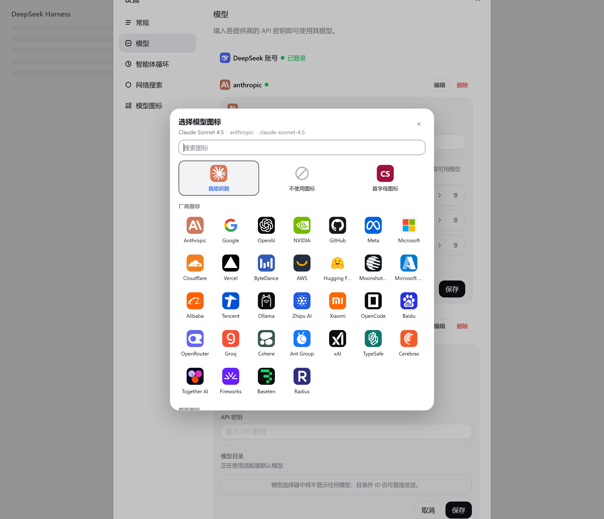

# dsh-model-logos

A DeepSeek Harness (DSH) Web GUI plugin that draws brand marks next to model and
provider names, and lets you choose a model's icon yourself when the automatic
choice is not what you want.


The plugin covers two families of icons, deliberately kept apart:

| Kind                        | What it identifies                       | Where it appears                                                                                                    |
| --------------------------- | ---------------------------------------- | ------------------------------------------------------------------------------------------------------------------- |
| **Vendor logo** (厂商 Logo) | the provider/channel that serves a model | Settings → Models provider rows, the Settings → Models editor titles, and every option of the add-provider dropdown |
| **Model logo** (模型 Logo)  | the brand of the model itself            | the composer model button, the model picker, and the model rows of the Settings → Models provider editor            |

Vendor logos only exist for the **official channel directory** (the shipped
provider routes). Hand-declared custom providers — a relay, a self-hosted server,
a local model URL — intentionally get no vendor logo, because there is no vendor
brand behind them.


The icon picker, from the running GUI:



## What it does

### Composer model label

A single contribution to the shipped `conversation.input.model.label` slot draws
the model's mark before the catalog name in all three placements the selector
uses it for:

| Placement | Where it shows                                             |
| --------- | ---------------------------------------------------------- |
| `trigger` | the model name in the composer's bottom-right model button |
| `menu`    | the current model in the picker's root menu row            |
| `option`  | every model row inside the picker                          |

It owns no interaction there: clicks, search, focus, check marks, reasoning-effort
labels and accessibility text stay with the shipped selector.

### Settings → Models

The plugin decorates the shipped Models page in place (idempotent and reversible):

- a **vendor logo** to the left of every official provider row and provider
  editor title, sized to the row's 14 px text (`1em`);
- a **model icon** at the start of every model configuration row. When the
  automatic choice finds no brand the row shows a dashed placeholder button
  instead of nothing, so the icon is always one click away;
- a custom **combobox** painted over the add-provider `<select>`: the native
  select stays the source of truth (and keeps receiving a bubbling `change`
  event), while the visible control shows each official channel with its vendor
  logo. Obscure channels without dedicated artwork fall back to a deterministic
  letter tile, so every official option still has a mark.

### Icon picker and overrides

Every model icon is resolved as:

1. **your explicit choice**, if one is stored for `provider + model`;
2. otherwise the **heuristic initial icon** (brand evidence from the model id and
   name, then the provider id/name);
3. otherwise no icon.

Clicking a model icon in Settings → Models, or a row on the new **Model icons**
settings page, opens a picker with:

- **Auto** — restore the heuristic initial icon;
- **No icon** — hide the mark for that model;
- **Letter icon** — a deterministic colour tile generated from the model name
  (the escape hatch for exotic local models that should not masquerade as a
  brand);
- **every brand mark** the plugin ships, with the current choice highlighted.

Overrides are pinned to the provider/model id pair, so two providers serving a
same-named model can show different marks. They are stored in the DSH **user
settings document** — the profile's `cordis.patch.yml`, under the plugin entry
`dsh-model-logos`:

```yaml
- id: dsh-model-logos
  name: dsh-model-logos
  config:
    modelIcons:
      deepseek-account:
        deepseek-flash: deepseek
      volcengine:
        doubao-seed-2-1-turbo-260628: letter
      anthropic:
        my-local-model: none
```

No network request, no localStorage, no state outside the DSH settings document.

## How matching works

`src/match.ts` is a pure, ordered heuristic over the provider and model identity
each surface exposes.

**Model logos** (`matchModelLogo`) run model-level rules first, so an aggregator
row such as `openrouter / anthropic/claude-sonnet-4.5` shows the Claude mark
rather than the OpenRouter mark. Examples: `deepseek`, `claude|anthropic`,
`gpt|o1…o9|chatgpt`, `gemini|gemma`, `qwen|qwq|tongyi`, `glm|chatglm|zhipu`,
`kimi|moonshot`, `minimax`, `mistral|mixtral`, `llama`, `grok|xai`,
`doubao|seed`, `ernie|wenxin`, `hunyuan`, `command-r`, `sonar|perplexity`,
`phi-N`, `nemotron`, `nova|titan`, `step-N`, `yi`, `mimo`. Provider-level rules
are the fallback for opaque model ids on a known provider.

**Vendor logos** (`matchVendorLogo`) are an explicit route-id table
(`VENDOR_CHANNELS`) covering the complete shipped channel directory — the pi-ai
catalog routes plus `deepseek-official` / `deepseek-account`. A rule list keeps
future region/plan variants (`xiaomi-token-plan-*`, `qwen-token-plan-*`, …)
resolving. Unknown ids return `null`: no vendor mark.

Matcher keys are a closed set (`LOGO_KEYS`); every key needs artwork.

## Artwork

Each brand is a hand-drawn, dependency-free 24×24 SVG tile (brand-coloured
rounded square, flat white glyph) so it renders identically offline and stays
legible at the shipped sizes (14 px in the composer trigger/menu, 16 px in
options, `1em`/16 px in Settings).

- `src/logos/cn.ts` — DeepSeek, Qwen, Zhipu/GLM, Kimi/Moonshot, MiniMax, Doubao,
  Baidu/ERNIE, Tencent/Hunyuan, StepFun, 01.AI.
- `src/logos/intl.ts` — OpenAI, Claude/Anthropic, Gemini, Meta/Llama, Mistral,
  xAI/Grok, Microsoft, NVIDIA, AWS, Cohere, Perplexity, Hugging Face, Ollama,
  Groq, OpenRouter.
- `src/logos/vendors.ts` — the remaining official channel brands: Xiaomi,
  OpenCode, Cerebras, Cloudflare, Together AI, Fireworks, GitHub,
  Vercel, Baseten, Microsoft Azure, Ant Ling, Radius, TypeSafe.
- `src/logos/index.ts` — the merged `LOGOS` set every renderer reads (the build
  validates coverage, duplicates and SVG safety before a bundle may ship).
- `src/artwork.ts` — runtime helpers: `letterTile(text)` (deterministic
  colour tile used for unknown official channels and for the picker's letter
  option) and the XML/HTML escapers.

The DeepSeek whale is the official asset shipped with this app
(`reference/deepseek-whale.svg`, taken from the Web front-end favicon); the rest
are vector reconstructions of each brand's official mark, redrawn for offline
use. Reconstructions differ from the official artwork by design: flat fills only,
a uniform tile, and glyphs simplified to survive 14 px. Brand logos are
trademarks of their owners and appear here only to identify the provider or model
being used. Replace any mark with an official asset when one is available under a
redistribution-friendly licence.

Two marks were corrected against the brands' current identities (both used to be
a plain letter "M" on the same orange tile, so they were easy to confuse):

- **MiniMax** is not an "M": the official mark is the 2025 pink-to-orange signal
  line (the nine-loop waveform). It is redrawn as a five-half-wave sine-wave
  segment on a magenta `#E2167E` tile, so it reads as a waveform at 14 px instead
  of a letterform.
- **Mistral** is the official 2025 pixel-block "M" (seven columns by five rows of
  squares, with stepped shoulders and split feet). The single-colour outline
  comes from `@lobehub/icons-static-svg` (MIT) and is flattened to a white glyph
  on the brand orange tile; the official yellow-to-red five-band gradient would
  turn to coloured noise at 14 px.

## Build

`client.js` and `index.js` are generated — never edit them by hand, and they are
not committed: they land in the package root only because the local DSH install
loads the bundle from disk. `npm install` regenerates them (via the `prepare`
script); after editing a source file run `npm run build` before reloading the
plugin in DSH. The sources are TypeScript:

- `src/client.ts` is bundled by esbuild into the browser module: one
  `window.__ModuleLoader__` factory closure with `react` / `react-dom/client` left
  external (the loader's `require` supplies them).
- `src/host.ts` is bundled into `index.js`, an ES module with
  `@deepseek-ai/schemastery` external.

Before writing either artifact, `scripts/build.ts` validates the artwork
(duplicates, non-empty titles, self-contained SVGs, coverage of every matcher
key, the generated letter-tile fallback) and the bundle's loader contract.

The whole toolchain — strict TypeScript, Vitest, oxlint, oxfmt, the module map
and the contribution rules — is documented in
[`docs/engineering.md`](docs/engineering.md).

```sh
npm run build          # generate client.js + index.js
npm run check          # fail when an artifact is missing or stale
npm test               # matcher + artwork + resolver + bundle tests (Vitest)
npm run typecheck      # tsc --noEmit
npm run lint           # oxlint
npm run fmt            # oxfmt --write .
npm run verify         # typecheck + lint + fmt:check + test + build + check
npm run preview        # design sheet -> .preview/logos.png
npm run preview -- --only claude      # one mark, large -> .preview/claude.png
npm run preview -- --only-set vendors # the vendor marks sheet
npm run verify:dom     # decorate the Settings fixture in headless Edge
npm run verify:live    # the running GUI serves this exact build
```

`scripts/preview-logos.ts` renders the marks at shipped sizes on light and dark
surfaces, next to a simulated composer trigger, model menu and Settings provider
rows, and captures the result with headless Edge. It is a design aid only, not
part of the bundle.

`scripts/verify-dom.ts` loads the real generated `client.js` in headless Edge
against `test/fixtures/settings-models.html` — a faithful static copy of the
shipped Settings → Models markup — with stubbed React/plugin services, then
asserts the vendor marks, the model-row buttons, the combobox replacement, the
picker write path, and clean disposal. It also renders
`docs/preview-settings.png`.

`scripts/verify-live.ts` recomputes the artifact revision the Host serves
(`SHA-1` over the bundle's mtime/ctime/size), fetches
`/plugins/??dsh-model-logos/client.js&rev=<rev>` from the running GUI and checks
the served bytes: a 200 proves the page's HMR transport has published exactly the
build in this directory, without restarting the app.

## Install

The bundle installs into a DSH profile with the Plugin Manager:

```
plugin_manager action=install_bundle target=<absolute path to this directory>
```

Then refresh the Web GUI page. The plugin appears in Plugins as **Model Logos** /
**模型 Logo**; disabling it removes every contribution and restores the plain
shipped interface.

**Upgrading from 0.1:** the host half now declares a settings field, so the Host
plugin entry must be reloaded once (toggle the plugin in the Plugin Manager, or
restart the app) before icon overrides can be saved. The browser half hot-reloads
through the usual client HMR transport. Until the Host half is reloaded, the
composer and Settings keep working with heuristic icons; the picker reports that
icon settings are unavailable.

## Implementation notes

- The label slot is `single`. A shipped label (`ui-deepseek-model-label-1017`)
  already occupies the default priority 0, and the slot API rejects two
  contributions at the same priority. This contribution registers at **priority
  -1**, which is the lowest priority and therefore the one that renders.
- Because it shadows that shipped label, it reproduces its visible behaviour: the
  `1017` release badge on the official `DeepSeek-V4.1-Flash` entry
  (`provider.id` `deepseek-account` / `deepseek-official`, `model.id`
  `deepseek-flash`).
- The settings namespace is declared by the Host half's volatile Config
  (`modelIcons: z.dict(z.dict(z.string())).volatile()`), so the browser reads and
  writes it through `ctx.configForms` / `remote.settings.mutate`; the value lands
  in the profile's `cordis.patch.yml` like every other user preference.
- The provider directory is read through the `remote.llm` projected service. The
  client must inject the exact key `remote.llm` (not just `remote`): Cordis
  refuses a namespace property read without it.
- The Models page renders the DeepSeek account row with its own localized label
  (`DeepSeek 账号` / `DeepSeek Account`), not the directory display name, so the
  decorator keeps a small alias table for that row.
- The Settings page is decorated through a scoped, idempotent MutationObserver:
  inserted nodes carry `data-dshml-owner`, the native provider `<select>` is only
  hidden (never replaced or removed), and disposal removes exactly the inserted
  nodes and restores the select. Spans inside our own inserted UI are never
  decorated again.
- `globalThis.__dshModelLogos` exposes a read-only diagnostics object (icon
  state, model catalog, re-run decoration); the live verification harness uses
  it.
- The stylesheet is injected once with a `data-plugin-css` tag and removed when
  the plugin disposes.
- `/model` command popup rows use the command popup's own rendering API, not this
  slot, so they keep plain names.

## Verification log

- Build validation rejects malformed artwork (missing title, non-`<svg>` string,
  `id` attributes, scripts, event handlers, external references), duplicate keys,
  and artwork keys no rule can reach.
- Matcher tests pin the configured providers, aggregator rows, provider
  fallbacks, the no-match case, all 44 official channel ids, and the closed
  `LOGO_KEYS`/artwork invariants.
- Artwork tests pin the letter-tile generator (determinism, safe SVG, CJK text,
  escaping) and the brand marks' inlining rules.
- Resolver tests pin override precedence (`brand` / `none` / `letter` / stale
  value), immutability, and per-provider keys.
- Bundle tests load the generated `client.js` in a DOM/React stand-in and check
  the label contribution (slot, priority −1, override rendering, letter and none
  sentinels, the shipped release badge), the settings-section registration, and
  that `apply()` disposers remove the stylesheet, listeners and observer.
- `scripts/verify-dom.ts` drives the faithful Settings fixture in headless Edge
  and screenshots the decorated page: **36 assertions pass** — vendor logos on
  official rows/editor titles (including the localized DeepSeek account row),
  none on the declared custom provider, model-row buttons and the 5-track grid,
  the hidden native select, the custom combobox (option marks, write-back,
  bubbling `change`, face re-sync), the picker write path into
  `configForms.mutate`, the composer label override/`none` rendering, full
  disposal reversibility and observer disconnection.
- Live verification against a real `dsh web` instance from this bundle (fresh
  profile, seeded providers, headless Edge over CDP): **15/15 assertions pass** —
  the settings dialog and both navigation entries, vendor logos before the
  DeepSeek account (localized label), DeepSeek and a configured `anthropic` row at
  14 px, model icons on the model rows (`claude-sonnet-4.5`, `my-local-qwen`), the
  add-provider combobox hiding the native select and listing every official
  channel with exactly one mark (write-back → `google`), the picker opening with
  41 options (auto / none / letter + all 38 brands) and a search box, the picked
  override persisted into the profile's `cordis.patch.yml`
  (`modelIcons: anthropic → claude-sonnet-4.5 → openai`), the row refreshing to
  the override, the Model-icons settings section listing the configured models,
  and no uncaught page errors. Screenshots: `docs/preview-live-settings.png`,
  `docs/preview-live-picker.png`.
- Visual check of every mark at 14/16/24/48/96 px, including the corrected
  MiniMax waveform and Mistral pixel-block M: `docs/preview.png`; the vendor
  marks: `docs/preview-vendors.png`; before/after of the two corrected marks:
  `docs/preview-corrected-marks.png`.
- Live bundle check with `scripts/verify-live.ts` against the running Web GUI:
  `/plugins/??dsh-model-logos/client.js&rev=cee18b707e67` returned the freshly
  built artifact (170,170 bytes served, 38 artwork entries), proving the client
  HMR transport published this exact build without an app restart.
