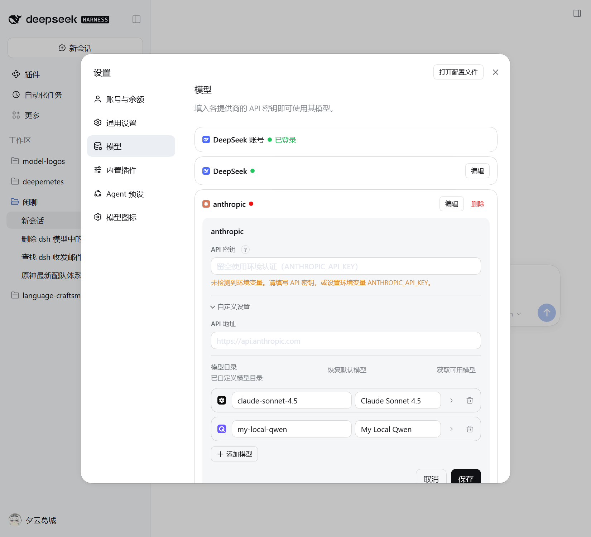
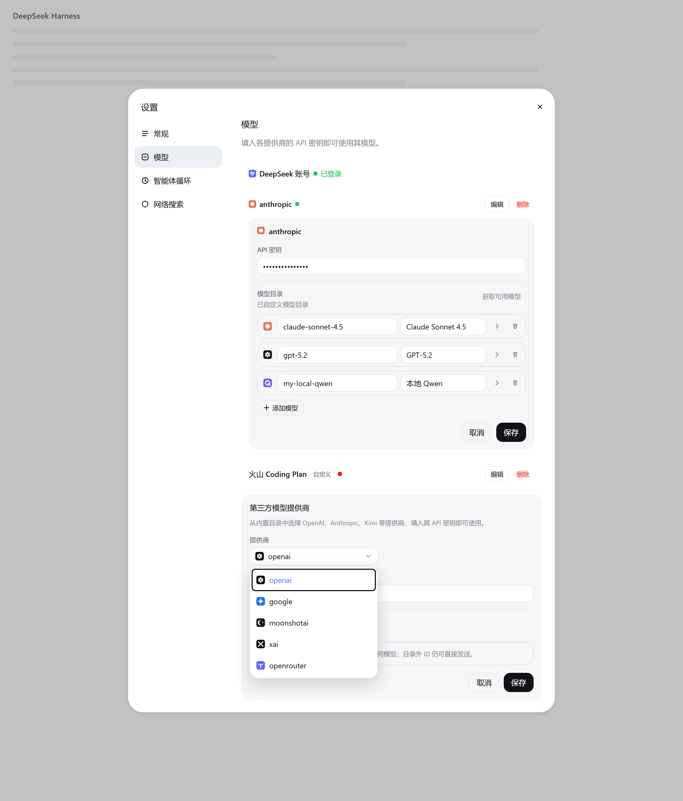
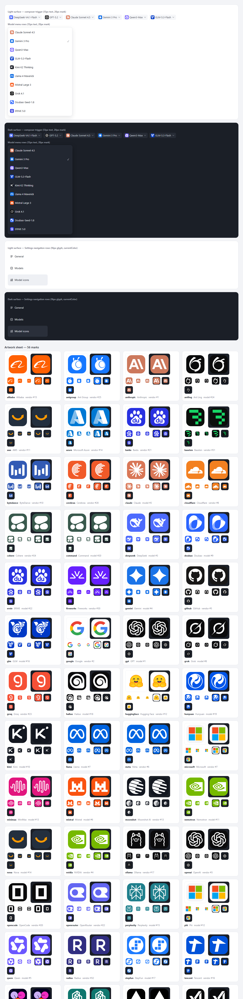

# dsh-model-logos

> 中文版：[README.zh.md](README.zh.md)

Brand marks for the models you actually use — a small plugin for the DeepSeek
Harness (DSH) Web GUI.


## Why icons?

A model picker used to be a short list. Today it is a crowd: DeepSeek, GPT, Claude,
Gemini, Qwen, GLM, Kimi, Doubao, Llama, Mistral… all rendered as the same grey
text. Reading every name is how you find the one you want; recognising a mark is
how you find it without reading. That is the whole case for icons: they move a
choice from recall to recognition.

The place it matters most is the model button in the composer — the control you
look at right before sending a message. The interface answers "which model is
this?" with a string of words. A mark answers it in one glance, the same reason a
phone's home screen is not a list of app names. Model names that differ by a suffix
are also easy to mix up, and the mark catches the mistake before you send.

Settings → Models makes the point even more plainly. Provider rows show a route id
such as `anthropic` or a display name, the add-provider dropdown lists more of the
same ids, and the model editor is a grid of text inputs. A logo gives every row a
shape you can find without decoding the text, and lets you choose a channel by
sight instead of by spelling.

There is a second, quieter idea in the plugin: **a model can have two brands.** The
_vendor_ is the channel that serves it — OpenRouter, Volcengine, a local relay. The
_model_ is the thing you are talking to — Claude, Qwen, DeepSeek. On an aggregator
row those are two different answers, so they get two different marks, and the
plugin is careful never to pass one off as the other.

## What it looks like

Settings → Models, in the running GUI: the vendor mark sits on every official
provider row and editor title, every model row begins with its mark or a one-click
placeholder, and the plugin's own entry sits in the Settings nav.



The provider rows and the add-provider dropdown up close, rendered from the same
markup by the verification harness — channels are chosen by logo, not by route id:



## What you get

- **The composer and the model picker** — the current model's mark in the composer
  button, on the current model at the top of the picker, and on every option row.
  Clicks, search, check marks and reasoning-effort labels stay with the built-in
  selector. The label itself is redrawn rather than wrapped — the slot holds only one
  label per place — so its component reproduces the model name and the release badge
  the built-in label shows. That is the plugin's one replacement.
- **Settings → Models** — a vendor logo on every official provider row and provider
  editor title, a model icon at the start of every model row (a dashed placeholder
  when there is no guess yet), and a logo-bearing combobox in place of the native
  add-provider `<select>` (the native select stays underneath as the source of
  truth).
- **A Model icons page** — the plugin's own Settings entry lists the models from
  your providers, with their current mark and a way to change it.
- **A picker you can always reach** — clicking a model's icon in Settings → Models
  opens it, and the Model icons page offers it per model, so fixing a wrong guess
  costs one click and no configuration-file editing.

Everything else is added around the existing interface, and disabling the plugin
removes the decoration and puts the page back as it was.

## Choosing an icon

Models are matched automatically first — a best-guess "initial" icon from the model
id and name, then from the provider. That is a useful default, not a rule, and every
model can be overridden:

- **Auto** — go back to the automatic choice;
- **No icon** — show no brand mark for that model;
- **Letter icon** — a deterministic colour tile made from the name, for local or
  exotic models that should look intentional rather than pretend to be a brand;
- **any included brand mark**, searchable.

Overrides are pinned to a `provider + model` pair, so two providers serving a
same-named model can show different marks. They live in the DSH user settings
document (the profile's `cordis.patch.yml`), next to your other preferences — not
in localStorage, and with no network request involved.

## The honest cases

- **Vendor logos only exist for official channels.** A relay, a self-hosted server
  or a local URL has no vendor brand behind it, so it gets no vendor logo — an
  invented one would be a lie. Every official channel still has a mark, falling back
  to a deterministic letter tile for the obscure ones.
- **A model with no confident match is not left blank.** The Settings row shows a
  dashed placeholder that is always one click away from the picker.
- **Names never disappear.** Every button and menu row still carries its name, so the
  interface stays usable even if you do not recognise a mark.

## Install

The bundle installs into a DSH profile through the Plugin Manager:

```
plugin_manager action=install_bundle target=<absolute path to this directory>
```

Then refresh the Web GUI page. The plugin appears in Plugins as **Model Logos** /
**模型 Logo**; disabling it removes the decoration and restores the plain interface.

## About the artwork

Every mark is a self-contained 24×24 SVG tile — a brand-coloured rounded square with
a glyph that stays legible at the sizes it is actually used (14–16 px beside UI
text). Nothing is fetched at runtime, so the artwork needs no network and no external
asset.

The DeepSeek whale is DeepSeek's official mark, taken from the app's own Web front
end. Most of the model marks are simplified vector reconstructions; the vendor marks
are official single-colour vectorisations (MIT / CC0 artwork) fitted into the same
tile, and a few glyphs — Microsoft, AWS, Hugging Face, Together AI, Baseten — keep
their brand colours. The two easiest to get wrong were corrected on purpose:
MiniMax's 2025 mark is a waveform, not an "M", and Mistral's pixel-block M keeps its
stepped shoulders. Brand logos are trademarks of their owners and appear here only to
identify the provider or model in use.



## Development

The toolchain requires Node.js ≥ 26.13.0 and pnpm (the exact version is pinned by
`packageManager`). `client.js` and `index.js` are generated build output — never edit
them by hand.

```sh
pnpm install          # dependencies; the prepare script also builds both artifacts
pnpm run build        # regenerate client.js + index.js after editing src/**
pnpm run verify       # full gate: types, lint, format, tests, build, artifact check
pnpm run verify:dom   # drive the real bundle against the Settings fixture in headless Edge
pnpm run preview      # render the artwork design sheet into .preview/
```

The module map, contribution rules and the verification log are in
[`docs/engineering.md`](docs/engineering.md); the runtime contract and design
decisions are in [`docs/architecture.md`](docs/architecture.md).

## Related

- [`docs/prior-art.md`](docs/prior-art.md) · [中文版](docs/prior-art.zh-CN.md) — how
  this plugin relates to the other DSH icon plugins.
- [`docs/awesome-plugin.md`](docs/awesome-plugin.md) — listing metadata and the
  submission checklist.
