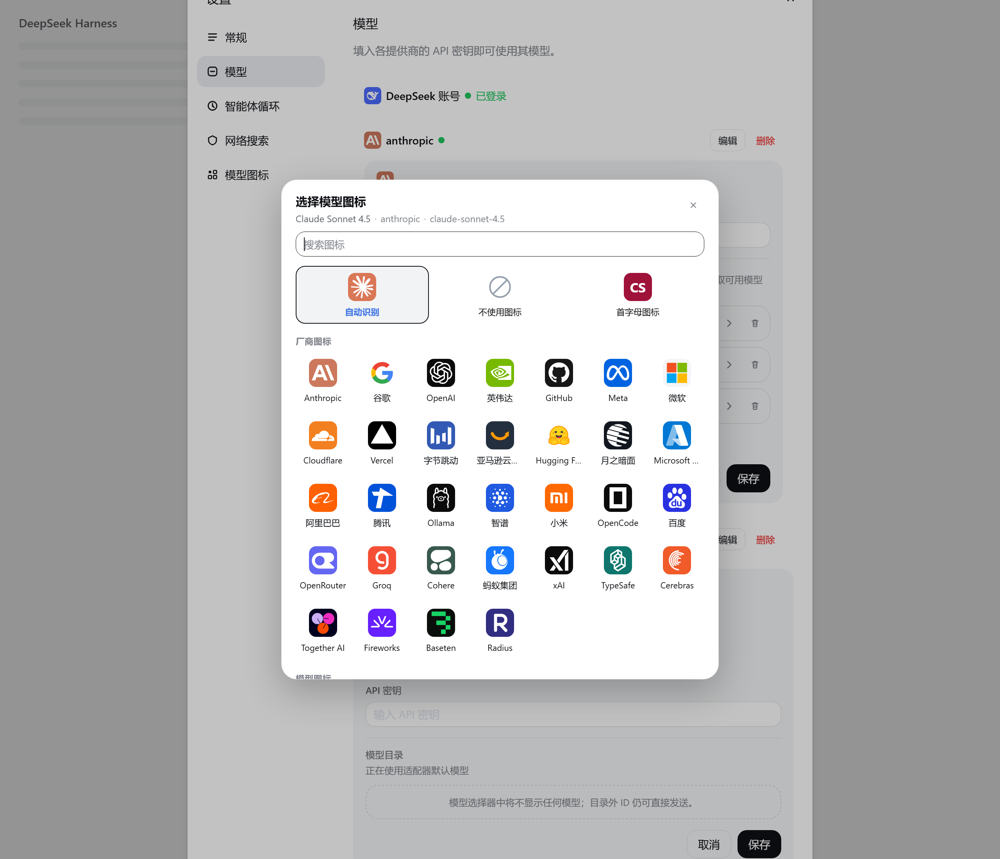
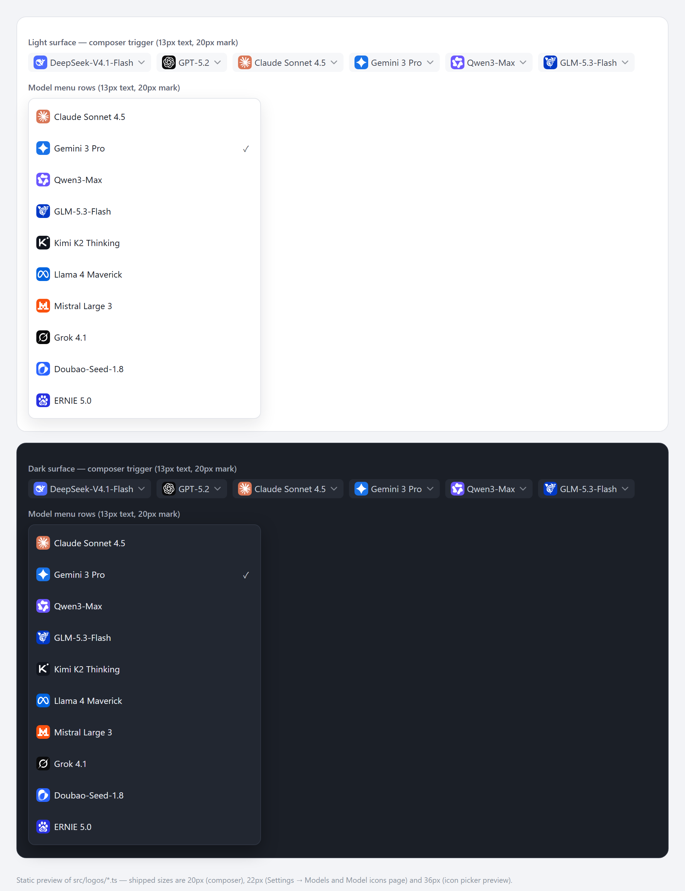
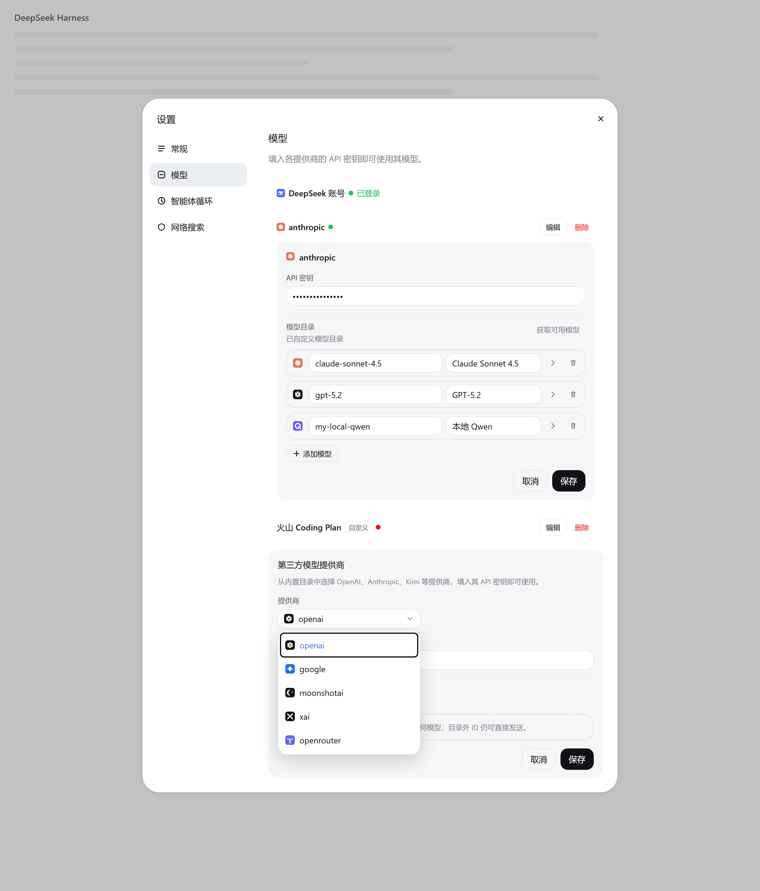
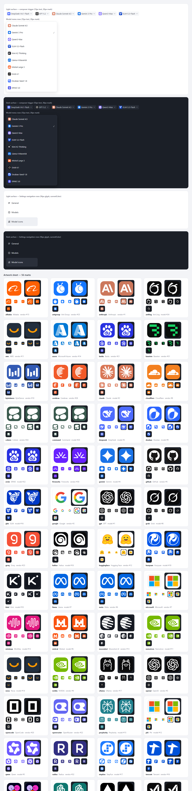

# dsh-model-logos

> English: [README.md](README.md)

为你真正在用的模型配上品牌标记 —— 一个为 DeepSeek Harness（DSH）Web 界面写的小插件。



## 为什么需要图标？

模型列表曾经很短。如今它是一片人海：DeepSeek、GPT、Claude、Gemini、Qwen、GLM、Kimi、豆包、Llama、Mistral……全都显示成同样的灰色文字。逐个读名字，是找到想要那个的办法；认出一枚标记，是不用读就能找到的办法。这就是图标成立的全部理由：它把选择从「回忆」变成「识别」。

最需要它的地方是输入区的模型按钮 —— 你发送消息前最后会看一眼的控件。界面用一串文字回答「这是哪个模型？」；而一枚标记能一眼回答，就像手机桌面不会只是一列应用名称。名字只差一个后缀的模型也很容易点错，标记能在发送前拦住这个错误。

这是那个按钮和它打开的菜单，按实际尺寸做出的静态预览 —— 13 px 标签旁 20 px 的标记，浅色与深色背景：



「设置 → 模型」把这一点体现得更直白：提供商行显示的是路由 id（例如 `anthropic`）或显示名，添加提供商下拉框又是一串 id，模型编辑器则是一格格文本输入框。一枚 Logo 让每一行有了凭形状就能找到的轮廓，也让选择通道可以靠看，而不是靠拼写。

插件里还有第二个更安静的想法：**一个模型可以有两个品牌。** _厂商_（vendor）是提供它的通道 —— OpenRouter、火山引擎、一个本地中转。_模型_（model）是你在对话的对象 —— Claude、Qwen、DeepSeek。在聚合器的一行里，这是两个不同的答案，所以它们得到两枚不同的标记，插件也谨慎地不让其中一个冒充另一个。

## 它长什么样

「设置 → 模型」，加载插件后：每一行官方提供商和每个编辑器标题左侧都预留 22 px 的标记位（官方通道填入厂商标记，手写提供商留空占位）；每个模型行开头都有预留 22 px 的图标位（模型标记，或一键可点的虚线占位）；添加提供商的原生 `<select>` 换成带 Logo 的自定义下拉框；插件自己的入口也在设置导航里。



这张装饰后的页面由校验脚本用同一份页面标记渲染 —— 通道是靠 Logo 选的，不是靠路由 id。

## 你得到什么

- **输入区和模型选择器** —— 模型按钮上是当前模型的标记，选择器顶部是当前模型，每个选项行也有标记。点击、搜索、勾选状态和推理强度标签仍归内置选择器所有。标签本身是重绘而非包裹（同一个位置只能容纳一个标签），因此这个组件会复现模型名和内置标签上的发布徽标。这是插件唯一一处「替换」。
- **设置 → 模型** —— 每个提供商行和提供商编辑器标题左侧都保留 22 px 的标记位：官方通道填入厂商 Logo，手写提供商留空占位；每个模型行开头有预留 22 px 的图标位（还没有把握时在图标位里显示虚线占位，标记出现时文字不会挪动）；盖在原生提供商 `<select>` 上的自定义下拉框带 Logo（原生 select 仍留在下面作为状态来源）。
- **「模型图标」页面** —— 插件自己的设置页会列出你提供商里的模型，显示它们当前的标记，并可以从这里修改。
- **随时可用的选择器** —— 在「设置 → 模型」里点模型的图标，或在「模型图标」页面按模型选择，就能打开它；改掉一次误判只需要一次点击，不用编辑配置文件。

除此之外都是围绕现有界面添加的；禁用插件会移除这些装饰，让页面恢复原样。

## 选择图标

插件会先自动匹配 —— 根据模型 id 和名称、再根据提供商给出一个「初始」图标。这是有用的默认值，不是规则，每个模型都可以覆盖：

- **自动识别** —— 回到自动匹配的结果；
- **不使用图标** —— 这个模型不显示品牌标记；
- **首字母图标** —— 用名称生成一个确定性的色块，适合那些既不想冒充品牌、又希望看起来像有意为之的本地或小众模型；
- **厂商图标** —— 公司或渠道的标记（Anthropic、Google、Alibaba、ByteDance、OpenRouter 等）；
- **模型图标** —— 模型产品的标记（Claude、Gemini、Qwen、豆包、Kimi 等）。

选择器把两组上下排布，并同时搜索两组。有些公司和模型共用一枚图形（DeepSeek、Mistral、MiniMax），这些标记放在模型组，官方渠道行复用同一枚 artwork；当两者确实不同时 —— Anthropic≠Claude、Google≠Gemini、Alibaba≠Qwen、ByteDance≠豆包 —— 选择器会同时提供两枚标记，而不是让其中一枚冒充另一枚。

组内按可量化的网络知名度排序，而不是按字母：一份可复现的快照综合 GitHub、npm、Wikipedia、Hugging Face 与 B 站信号，让真正会被找的标记排在前面。方法与原始数据见 [`docs/rankings.md`](docs/rankings.md)。

覆盖项绑定在 `provider + model` 这一对上，所以两个提供商服务同名模型时可以显示不同标记。它们保存在 DSH 用户设置文档里（配置档的 `cordis.patch.yml`），和其他偏好放在一起 —— 不用 localStorage，也不产生任何网络请求。

## 诚实面对的情况

- **厂商 Logo 只属于官方通道。** 中转、自建服务器或本地 URL 背后没有厂商品牌，所以没有厂商 Logo —— 编造一个出来就是在撒谎。名称左侧的标记位仍然保留（留空）让各行对齐；每个官方通道都有标记，冷门通道回退为确定性的字母色块。
- **没把握的模型不会被留白。** 设置里的那一行会保留 22 px 的图标位并显示虚线占位，一点就能打开选择器 —— 真正的标记出现时名称不会跳动。
- **名称始终都在。** 每个按钮、每个菜单行仍然带着名字，即使不认识标记，界面也照样可用。

## 安装

把公开仓库添加到 DSH 配置档：

```sh
dsh plugin --profile web add github:Altermoe/dsh-model-logos
```

源码安装会在本机构建插件 —— 仓库的 `prepare` 脚本会执行 `pnpm run build` —— 因此需要
Node.js ≥ 26.13.0 与 pnpm，市场上首次安装时也会请求一次构建授权。预构建的发布 tarball 还在
计划中；在那之前，本地检出也可以走插件管理器安装：

```
plugin_manager action=install_bundle target=<指向本目录的绝对路径>
```

然后刷新 Web 界面。插件在「插件」里显示为 **Model Logos** / **模型 Logo**；禁用它就会移除装饰，恢复原本的界面。

## 关于这些图标

每一枚标记都是自包含的 24×24 SVG 方块 —— 品牌色的圆角方块，加上在实际使用尺寸（输入区模型按钮旁的 20 px，设置行旁的 22 px，图标选择器预览里的 36 px）下仍然清晰可辨的图形。运行时不拉取任何东西，所以这些图标不需要网络，也不依赖外部资源。

图形不是靠肉眼重画的，而是来自固定版本的官方矢量集 —— [`@lobehub/icons-static-svg`](https://github.com/lobehub/lobe-icons) 1.102.0（MIT），加上 Simple Icons（CC0）的 Xiaomi，以及取自本应用 Web 前端的 DeepSeek 官方鲸鱼 —— 由入库的导入脚本统一收进同样的方块。构建检查会把生成的路径数据与已提交的上游文件逐条比对，所以想改一枚标记，只能改它的来源。少数例外在源码里注明：Radius 没有官方图形；AWS 保留官方 smile 符号，因为完整字标在图标尺寸下不可读；Xiaomi 保留 Simple Icons 的「mi」。

原先偏差最明显的标记从来源层修正：Claude 换成官方不规则实心放射状、Ollama 换成正面看镜头的羊驼、豆包换成官方女性形象，替换掉旧的齿轮、侧脸剪影和聊天气泡。MiniMax 2025 年的波形与 Mistral 的像素方块 M 保留此前校正过的形状。品牌 Logo 是其所有者的商标，在此仅用于标识实际使用的提供商或模型。



## 开发

工具链要求 Node.js ≥ 26.13.0 与 pnpm（确切版本由 `packageManager` 固定）。`client.js` 与 `index.js` 是生成的构建产物 —— 不要手工编辑。

```sh
pnpm install          # 安装依赖；prepare 脚本同时构建两个产物
pnpm run build        # 修改 src/** 后重新生成 client.js + index.js
pnpm run verify       # 完整门禁：类型检查、lint、格式化、测试、图标/排序校验、构建、产物一致性
pnpm run verify:dom   # 在无头 Edge 中用真实 bundle 驱动 Settings 测试页面
pnpm run preview      # 生成图标设计总览到 .preview/
pnpm run logo:check   # 校验入库图标与固定版本官方矢量一致
pnpm run rank:check   # 校验选择器顺序与提交的热度快照一致
```

模块图、贡献规则与验证日志在 [`docs/engineering.md`](docs/engineering.md)；运行时契约与设计决策在 [`docs/architecture.md`](docs/architecture.md)。

## 相关文档

- [`docs/prior-art.md`](docs/prior-art.md) · [中文版](docs/prior-art.zh-CN.md) —— 这个插件与其他 DSH 图标插件的关系。
- [`docs/awesome-plugin.md`](docs/awesome-plugin.md) —— 上架元数据与提交清单。
